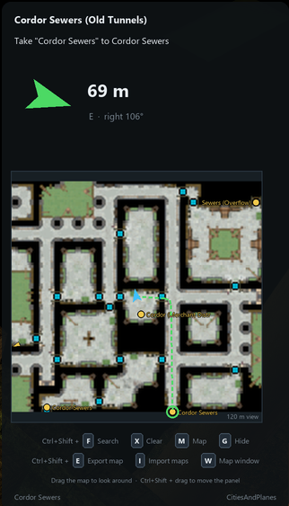
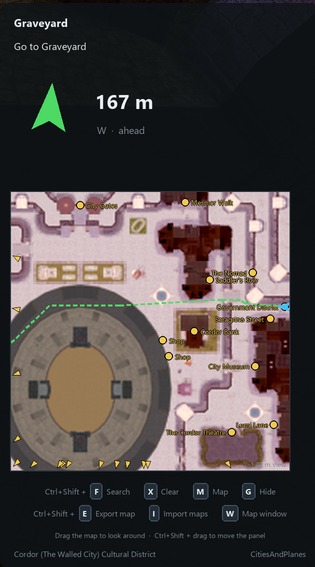
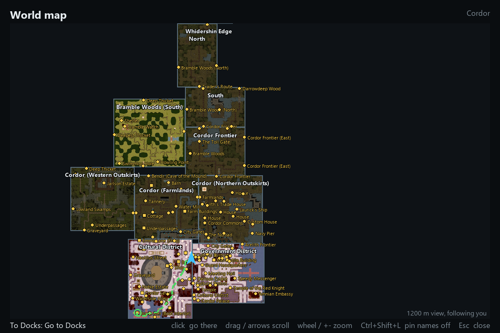

# NWN GPS

**A GPS for Neverwinter Nights: Enhanced Edition multiplayer servers.** It maps the world as you
play, finds any place you (or your friends) have been, and guides you there with an in-game panel:
an arrow, the distance on foot, the next step and a live map of the area. Works in fullscreen.

  
  &nbsp;
  

**[Download the latest release](https://github.com/KingSideKnight/nwn-gps/releases)** ·
**[User guide](USER_GUIDE.md)** · Free and open source (MIT)

> NWN GPS reads the game's memory and loads a small add-on into the running game to draw its
> panel. It never changes game files, saves or characters. **Some servers restrict third-party
> tools: check your server's rules first.**

## What it does
- **Search and go.** Press Ctrl+Shift+F, type part of a name (a shop, a door, an area, a map pin)
  and click the result. The panel turns you toward it, area after area, until you arrive.
- **Directions that follow the ground.** Inside an area, the route goes along streets, corridors
  and doorways instead of through walls and water, and the distance is how far it is on foot.
  Across areas, it routes through the doors and exits you've actually used, including portals
  between linked servers.
- **A live map in the panel**, drawn from the area's real tile art, with map pins, doors and your
  saved places. Drag it to look around.
- **A full-screen world map** (Ctrl+Shift+M). Outdoor areas are stitched together into one map as
  you explore, and buildings appear at their doors. Click anything on it to go there.
- **Saved places.** Star your home, the bank or a spot in the wilds and get back in two key presses.
- **Map window (experimental).** The world map in its own window, for a second monitor, a TV or a
  tablet used as a screen. It never takes the keyboard from a fullscreen game.
- **Share maps with friends.** Export your map and send the file; they import it and get every
  place you've found. What you've seen yourself always wins, and an import can be undone.
- **Built for real servers.** Teleports, deaths and DM moves don't turn into directions, and maps
  that a server changes are updated without losing anything. Servers split into linked servers
  (like Arelith) share one map.

  

## Get started
1. Download `NWN-GPS-<version>.zip` from the
   [Releases page](https://github.com/KingSideKnight/nwn-gps/releases) (under **Assets**, not
   "Source code").
2. Extract it to a folder of its own, for example `C:\Games\NWN-GPS`, and run `NWN-GPS.exe`.
   Windows may warn that it doesn't know the program: click **More info**, then **Run anyway**.
3. Start the game normally and join a server. The panel appears near the bottom-right corner.

Nothing is installed: to remove it, delete its folder and `Documents\NWN GPS`. The
[user guide](USER_GUIDE.md) covers everything else, including antivirus warnings and Windows 11's
Smart App Control.

## Keys
| Keys | What it does |
|---|---|
| **Ctrl+Shift+F** | Search for a destination, or pick a saved place |
| **Ctrl+Shift+X** | Clear the destination |
| **Ctrl+Shift+M** | Full-screen world map |
| **Ctrl+Shift+G** | Hide / show the panel |
| **Ctrl+Shift+E / I** | Export your map / import maps from friends |
| **Ctrl+Shift+W** | Map window on / off |
| **Ctrl+Shift + drag** | Move the panel |

The panel shows its keys at the bottom, and you can change them in Settings.

## Safety and privacy
- **It only reads and draws.** It reads the game's memory to see where you are and draws its
  panel over the game. It doesn't move your character or play for you, and never changes game
  files.
- **Nothing leaves your PC** except a once-a-day check for a new version (one request to GitHub,
  which you can turn off). Your maps stay in `Documents\NWN GPS`. Your CD key and account name are
  never stored or logged.
- **Careful with game updates.** It only runs on game builds it knows (currently 8193.37-17) and
  safely refuses others until it gets an update.
- **Open source.** Every line is here to read, and each release lists the zip's SHA-256 so you can
  check your download. It isn't code-signed yet, which is why Windows may warn the first time.

See [SECURITY.md](SECURITY.md) for the full picture.

## Requirements
- Neverwinter Nights: Enhanced Edition on Windows (Steam, GOG or Beamdog), game build 8193.37-17.
- Built and tested on Arelith. Other servers should work too: each server gets its own map.

## Feedback
Found a bug, or a route that goes somewhere strange? Please
[open an issue](https://github.com/KingSideKnight/nwn-gps/issues) with what happened and the log
files from `Documents\NWN GPS\logs`.

Unofficial fan-made tool, not affiliated with Wizards of the Coast, Beamdog or any server.

## For developers

### How it works
- **Reading:** `nwngps/session.py` reads `nwmain.exe` memory with read-only access (area, position,
  pins, doors, tiles). Offsets live in `nwngps/layout.py`; `session.check_layout` verifies every
  class vtable via RTTI at attach and refuses unknown game builds.
- **Recording:** `nwngps/recorder.py` -> SQLite per world (`db.py`), including portals between
  linked servers. `nwngps/edges.py` classifies each area change (walk / portal / jump / death /
  respawn) so teleports, deaths and DM moves don't become directions. DM client support
  (`"dm_mode"`) is experimental and untested. Server-side map changes are tracked per visit
  (`Store.end_visit` / `check_layout`): changed layouts are replaced, pins / doors missing 3 visits
  in a row are retired, and links out of removed or re-pointed exits go stale. Nothing is deleted,
  and the `changes` table lets `cli restore` undo each one.
- **Drawing in-game:** `native/nwngps_gl.c` is loaded into the game at runtime; it swaps
  `GDI32!SwapBuffers` in nwmain's import table, draws a texture Python publishes through shared
  memory, reads hotkeys via a window subclass, and unhooks/unloads on request. No game files change.
- **Maps:** tile layouts from memory + tileset art from NWSync / texture packs / KEY-BIF
  (`resources.py`, `maps.py`, `worldmap.py`). Areas that land on top of each other are slid
  along their shared edge, else the smallest branch hanging off one join is moved clear and that
  join is drawn as a dashed line (`_settle` / `_separate`; `tests/test_worldmap_overlap.py` checks
  random worlds never overlap). Dragging the panel's mini map pans it (DLL v5 writes the drag to
  `panel_drag_*`; `ingame.MapPan` glides it back on release). Clicks on the full map arrive as `EV_MAPCLICK`
  events and are hit-tested against what the last frame drew (`FullMap.pick_at`).
- **Walking paths:** `walkmesh.py` lays out each tile's walkmesh (.wok, restype 2016; walkable
  materials from surfacemat.2da) like the tile art into a 0.5 m grid, cached as `<map key>.walk1`
  beside the map PNGs. `Paths` runs A* (no corner cutting, then string-pulled to a few turns) on
  its own thread; `Navigator` takes the result for the arrow (next turn) and distance (on foot) and
  falls back to a straight line without one. Server content is capped and validated; an area with
  mostly unreadable walkmeshes gets no grid (`tests/test_walkmesh.py`).
- **Map window (experimental):** `mapwindow.py` is a third launcher part, idle until `"map_window"` is on
  (Ctrl+Shift+W = `EV_WINDOW`, DLL v6, flips it in settings.json). A worker thread with its own
  read-only `Session` and `Store` draws `FullMap` frames; tkinter only shows them. The window is
  `WS_EX_NOACTIVATE` so clicking it never takes focus from a fullscreen game; `place()` picks a
  monitor the game isn't on and drops a remembered spot whose monitor is gone
  (`tests/test_mapwindow.py`).
- **Saved places:** `pois` rows of kind `"user"` (`Store.save_place` / `remove_place`), named in
  the picker's naming mode (`picker.py`). Visits never retire them, `exit_places` / `nearest_poi`
  ignore them (pins and doors only), shared exports drop them unless `"share_places"`, and
  `merge` skips another map's (`tests/test_saved_places.py`).
- **Settings and updates:** `settings_window.py` (tkinter; S in the launcher window) writes
  settings.json, which the in-game part re-reads live. `updates.py` is the only network code: a
  daily GitHub release check, opt-out, never downloads.

### Run from source
    native\build.cmd                  # once (Visual Studio 2022 C++ tools)
    python -m pip install pillow numpy
    python -m nwngps                  # launcher: recorder + in-game GPS (or start_gps.cmd)
    python -m nwngps cli --help       # search, routes, export/merge, world map
    python -m unittest discover -s tests

Settings: `Documents\NWN GPS\settings.json`. Data: `Documents\NWN GPS\data`, logs:
`Documents\NWN GPS\logs` (set `NWNGPS_DATA` to override the data folder). The in-game DLL is loaded
from `<app folder>\runtime`, falling back to `Documents\NWN GPS\runtime`.

Why not AppData: processes started from a packaged (MSIX) Windows app, such as a terminal inside one,
get AppData silently redirected to a private per-app copy. Data, logs and the DLL written there are
invisible to the same tool started from Explorer, and to the game. `pip install --user` is affected
the same way, so install Pillow and numpy system-wide or use the packaged exe.

Scale (synthetic, `recon/scale_test.py 3888`): 5,125 areas (3,844 placed on one map, 1,281 interiors),
192,200 POIs, 12,627 transitions = 35 MB; search 4 ms, whole-world route 155 ms, full-screen map
frame 115 ms (the first one 525 ms: it also builds the world map and scales the visible tile art).

### Layout
- `nwngps/` application (`__main__.py` entry point, `config.py` paths/settings)
- `native/` the in-game DLL (C, ~600 lines, no third-party code)
- `tests/` unit tests; `recon/` reverse-engineering tools and notes (`recon/FINDINGS.md`)

### Security
See [SECURITY.md](SECURITY.md) for the trust model, attack surfaces and protections
(`tests/test_security.py` covers hostile map files, server content limits and DLL integrity).

### License
MIT (see `LICENSE`). Bundled third-party components: `THIRD_PARTY_NOTICES.txt`.
Build a release with `python packaging/build_release.py` (needs PyInstaller).

### Supported game build
Neverwinter Nights: Enhanced Edition 8193.37-17 (26c6e573, Oct 2025). Other builds are detected
and refused until `layout.py` is updated (re-run `recon/find_vtables.py` and the probes).
